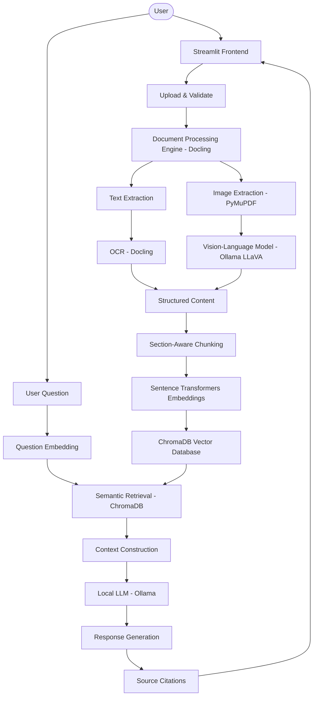

# 🧠 LLM-Powered Multimodal Document Intelligence System

> **Track B: Transformers & LLM Pipelines (Unit 4)**  
> Advanced Deep Learning · Pretrained Transformers · Vision-Language Models · RAG

---

## 📖 Project Description

The **Multimodal Document Intelligence System** is a complete, locally-running AI platform that lets you upload PDF, DOCX, PPTX, and image files and then interrogate their content — including text, tables, figures, and diagrams — using natural language.

Unlike basic PDF chatbots that only read extracted text, this system:

- **Understands structure** — headings, paragraphs, sections, tables.
- **Understands visuals** — diagrams, charts, graphs, and figures via a Vision-Language Model.
- **Generates grounded answers** — every response cites the exact document and page it was drawn from.
- **Runs entirely locally** — no OpenAI key, no cloud calls, no data leaves your machine.

---

## ❓ Problem Statement

Academic researchers, engineers, and analysts spend enormous amounts of time manually reading, cross-referencing, and extracting information from large document collections. Existing tools either:

1. Only handle text (ignoring figures, tables, and diagrams), or  
2. Require expensive cloud APIs that leak sensitive research data.

---

## 🎯 Motivation

This project demonstrates that a **fully local, CPU-compatible AI pipeline** can deliver research-grade document understanding by combining:

- State-of-the-art document parsing (Docling)
- Semantic search (Sentence Transformers + ChromaDB)
- Retrieval-Augmented Generation (custom RAG pipeline)
- Vision-Language Models (Ollama + LLaVA)

---

## ✨ Major Features

| Feature | Description |
|---------|-------------|
| 📤 **Multi-format Upload** | PDF, DOCX, PPTX, PNG, JPG, TIFF |
| 🔍 **Semantic Search** | 384-dim embeddings + ChromaDB similarity search |
| 🤖 **RAG Q&A** | Grounded answers with document + page citations |
| 👁️ **Vision Understanding** | AI descriptions of figures, charts, and diagrams |
| 📝 **9 Summary Types** | Short, detailed, executive, research-structured, and more |
| 🔀 **Multi-doc Comparison** | Side-by-side comparison table across research dimensions |
| 📊 **Table Extraction** | CSV and Excel export of detected tables |
| 💬 **Conversational Memory** | Follow-up questions maintain session context |
| 🧪 **Evaluation Dashboard** | Recall@K, citation accuracy, response-time metrics |
| 🔒 **100% Local** | All processing on-device; no external API calls |

---

## 🛠️ Technology Stack

| Layer | Technology |
|-------|-----------|
| Frontend | Streamlit |
| Document Parsing | Docling |
| PDF Processing | PyMuPDF (fitz) |
| OCR | Docling built-in OCR |
| Office Formats | python-docx, python-pptx |
| Image Processing | Pillow, OpenCV |
| LLM | Ollama (qwen2.5:3b recommended) |
| Vision-Language Model | Ollama (llava:7b recommended) |
| Embeddings | sentence-transformers/all-MiniLM-L6-v2 |
| Vector Database | ChromaDB (persistent local storage) |
| Metadata Database | SQLite |
| Visualisation | Plotly |
| Configuration | python-dotenv |
| Testing | pytest |

---

## 🏗️ System Architecture



---

## 📁 Project Structure

```
Multimodal-Document-Intelligence/
│
├── app.py                          # Landing page & Streamlit entry point
│
├── pages/
│   ├── 1_Dashboard.py              # Statistics & activity overview
│   ├── 2_Upload_Documents.py       # File upload, validation & indexing
│   ├── 3_Document_Library.py       # Document management & deletion
│   ├── 4_AI_Assistant.py           # Conversational RAG interface
│   ├── 5_Summarization.py          # Document summarization (9 types)
│   ├── 6_Visual_Analysis.py        # Image gallery with VLM descriptions
│   ├── 7_Table_Extraction.py       # Table viewer & CSV/Excel export
│   ├── 8_Document_Comparison.py    # Multi-document comparison
│   ├── 9_Evaluation.py             # Evaluation dashboard & metrics
│   └── 10_Settings.py              # Configuration & connection status
│
├── modules/
│   ├── config.py                   # Centralised configuration (env vars)
│   ├── database_manager.py         # SQLite metadata persistence
│   ├── document_processor.py       # Docling orchestration & file ingestion
│   ├── chunking.py                 # Section-aware text chunking
│   ├── embeddings.py               # Sentence Transformer embeddings
│   ├── vector_database.py          # ChromaDB operations
│   ├── rag_pipeline.py             # Full RAG pipeline + indexing
│   ├── llm_handler.py              # Ollama text & vision generation
│   ├── vision_processor.py         # VLM image description pipeline
│   ├── summarizer.py               # Map-reduce document summarization
│   ├── document_comparator.py      # Multi-document comparison engine
│   ├── table_extractor.py          # Table loading & export helpers
│   └── evaluation.py               # Evaluation metrics & dataset management
│
├── database/
│   ├── chroma_db/                  # ChromaDB persistent vector store
│   └── metadata/documents.db       # SQLite document metadata
│
├── data/
│   ├── uploads/                    # Stored original files
│   ├── processed/                  # Extracted Markdown + JSON per doc
│   ├── extracted_images/           # Images extracted from documents
│   ├── outputs/                    # Evaluation results & exports
│   └── cache/                      # Temporary processing cache
│
├── tests/                          # pytest unit tests (no live models needed)
├── evaluation/                     # Evaluation dataset CSV
├── assets/                         # Logo and static assets
│
├── .env                            # Your local configuration (git-ignored)
├── .env.example                    # Template configuration
├── .gitignore
├── requirements.txt
├── README.md
└── architecture.md                 # Detailed module architecture
```

---

## 🚀 Installation (Windows 11 — PowerShell)

### Step 1: Clone or Navigate to the Project

```powershell
cd d:\Projects\Multimodal-Document-Intelligence
```

### Step 2: Create a Virtual Environment

```powershell
py -3.10 -m venv .venv
```

### Step 3: Activate the Virtual Environment

```powershell
.\.venv\Scripts\Activate.ps1
```

> If you get an execution policy error, run first:
> ```powershell
> Set-ExecutionPolicy -Scope CurrentUser -ExecutionPolicy RemoteSigned
> ```

### Step 4: Upgrade pip and Install Dependencies

```powershell
python -m pip install --upgrade pip
pip install -r requirements.txt
```

> **Note:** The first install downloads PyTorch (~200 MB) and Sentence Transformers. This is a one-time operation.

### Step 5: Install Ollama

1. Visit **[ollama.com](https://ollama.com)** and download the Windows installer.
2. Run the installer.
3. Verify installation:
   ```powershell
   ollama --version
   ```
4. Start the Ollama server (keep this terminal open):
   ```powershell
   ollama serve
   ```

### Step 6: Download AI Models

```powershell
# Text/reasoning model (recommended — ~2 GB)
ollama pull qwen2.5:3b

# Vision-Language model for image understanding (optional — ~4.7 GB)
ollama pull llava:7b

# Verify models are installed
ollama list
```

**Lightweight alternatives (if RAM is limited):**
```powershell
ollama pull qwen2.5:1.5b   # ~1 GB — very fast
ollama pull phi3:mini       # ~2.3 GB — good quality
```

### Step 7: Configure Environment Variables

```powershell
Copy-Item .env.example .env
notepad .env
```

Key settings to verify in `.env`:

```env
OLLAMA_BASE_URL=http://localhost:11434
OLLAMA_MODEL=qwen2.5:3b
OLLAMA_VISION_MODEL=llava:7b
EMBEDDING_MODEL=sentence-transformers/all-MiniLM-L6-v2
CHUNK_SIZE=800
CHUNK_OVERLAP=120
TOP_K=5
```

### Step 8: Run the Application

```powershell
streamlit run app.py
```

The application opens at: **http://localhost:8501**

---

## 📖 Usage Guide

### 1. Upload Documents
Navigate to **Upload Documents** → select files → choose processing options → click **Process & Index**.

### 2. Ask Questions
Go to **AI Document Assistant** → select document(s) → type your question → press Enter.

### 3. Generate Summaries
Open **Summarization** → pick a document → choose a summary type → click **Generate Summary**.

### 4. Compare Documents
Go to **Document Comparison** → select 2–5 documents → pick dimensions → click **Compare Documents**.

### 5. Explore Images
Open **Visual Analysis** → select a document → browse extracted images and their AI descriptions.

### 6. View Tables
Navigate to **Table Extraction** → select a document → view, search, and export tables as CSV/Excel.

### 7. Run Evaluation
Open **Evaluation** → add Q&A pairs in the Dataset tab → run the evaluation → view metrics.

---

## 📂 Supported File Formats

| Format | Extension | Features |
|--------|-----------|---------|
| PDF | `.pdf` | Text, tables, images, OCR for scanned pages |
| Word | `.docx` | Headings, paragraphs, tables |
| PowerPoint | `.pptx` | Slides, text, tables |
| Images | `.png .jpg .jpeg .tiff` | OCR text extraction, VLM description |

---

## 🔬 RAG Pipeline Explained

```
User Question
    │
    ▼
Sentence Transformer → 384-dim query vector
    │
    ▼
ChromaDB cosine similarity search
    │   (filtered to selected documents)
    ▼
Top-K most relevant chunks (text + table + image descriptions)
    │
    ▼
Context construction (chunk text + source metadata)
    │
    ▼
System prompt:
  "Answer ONLY from the evidence provided.
   Cite document name and page. Never invent facts."
    │
    ▼
Ollama LLM (local, no cloud)
    │
    ▼
Answer + Citations (filename + page number)
```

---

## 👁️ Multimodal Processing

When **Enable image description (VLM)** is checked during upload:

1. PyMuPDF extracts embedded images from each PDF page.
2. Each image is screened for minimum size (50×50 px, > 2 KB).
3. Qualifying images are sent to the configured VLM (e.g., `llava:7b`) via Ollama.
4. The VLM returns a detailed textual description of the figure/diagram/chart.
5. Descriptions are saved to disk and chunked into the vector database.
6. When you ask "Explain Figure 3", the RAG pipeline retrieves the matching description and grounds the LLM answer in it.

**Important:** The system never fabricates visual descriptions. If the VLM is not installed or doesn't support images, a clear error is shown — not a fake description.

---

## 🧪 Evaluation Methodology

Metrics measured on real system runs:

| Metric | Description |
|--------|-------------|
| **Recall@K** | Was the correct document/page in the top-K retrieved chunks? |
| **Citation Accuracy** | What fraction of retrieved chunks match the expected source? |
| **Keyword Overlap (F1)** | Token-level F1 between expected and generated answers |
| **Response Time** | Total, retrieval, and generation timing per query |

### Experiments

| # | Experiment |
|---|-----------|
| 1 | Keyword vs semantic retrieval (vary embedding vs BM25) |
| 2 | Text-only vs multimodal processing (with/without VLM descriptions) |
| 3 | TOP_K sensitivity: 3 vs 5 vs 10 retrieved chunks |
| 4 | Chunk size impact: 400 vs 800 vs 1200 characters |
| 5 | Model comparison: response quality and latency across different Ollama models |

---

## ⚠️ Known Limitations

- **Large documents (> 100 pages):** Processing is slower on CPU; use `MAX_PAGES_PER_DOC` to limit.
- **Vision model required for image Q&A:** `llava:7b` requires ~5 GB RAM. Use `moondream` for a lighter option.
- **Mathematical expressions:** Equation recognition depends on Docling's PDF parsing quality.
- **Complex scanned PDFs:** OCR quality varies with scan resolution. 300 DPI or above is recommended.
- **Table detection:** Highly formatted or merged-cell tables may be extracted partially.
- **Ollama first-load:** The first LLM call loads the model into RAM (~2-30 seconds depending on model size).

---

## 🔮 Future Scope

- Support for `.epub`, `.html`, and `.txt` files.
- Real-time streaming responses from the LLM.
- BM25 hybrid retrieval combining keyword + semantic scores.
- Fine-tuned embedding model on domain-specific corpora.
- User authentication and multi-user document libraries.
- Export conversation history as PDF report.
- Graph-based document relationship visualisation.

---

## 🔧 Troubleshooting

| Problem | Solution |
|---------|----------|
| `Cannot connect to Ollama` | Run `ollama serve` in a terminal |
| `Model not installed` | Run `ollama pull qwen2.5:3b` |
| `Vision model fails` | Run `ollama pull llava:7b`; check with `ollama list` |
| `Out of memory` | Switch to `qwen2.5:1.5b`; reduce `CHUNK_SIZE` |
| `Docling processing error` | Check file is not password-protected or corrupted |
| `ChromaDB error` | Delete `./database/chroma_db/` and re-index |
| `Port 8501 in use` | Run `streamlit run app.py --server.port 8502` |
| `slow embedding` | Reduce `EMBEDDING_BATCH_SIZE` in `.env` |
| `Import error` | Activate venv: `.\.venv\Scripts\Activate.ps1` then reinstall |

---
